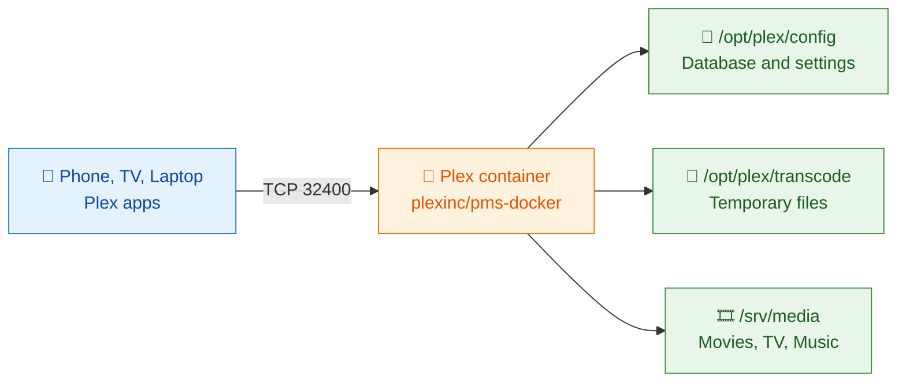

<a name="top"></a>
 
<div align="center">
  
# 🎬 How to Set Up Plex Media Server on VPS with Docker in 2026?
 
### Build your own private streaming service that runs 24/7, in about 20 minutes
 


 
[🚀 Quick Start](#steps) • [🔒 Security](#security) • [🧯 Troubleshooting](#troubleshooting) • [☁️ QloudHost Plex VPS](#qloudhost) • [❓ FAQs](#faqs)
 
</div>
---
 
> [!TIP]
> **⚡ TL;DR**
> - 🖥️ **You need:** A Linux VPS with root access (Ubuntu 24.04 in this guide), a free Plex account and about 20 minutes.
> - 🐳 **You build:** Plex Media Server in one Docker container, using the official `plexinc/pms-docker` image, with your settings and media in folders you control.
> - 🔁 **How it works:** Update the server, install Docker, create folders, write a compose file, claim the server with a token, open port `32400` and add your libraries.
> - 💳 **Heads up:** Remote playback of personal media needs a Plex Pass or Remote Watch Pass, and most VPS plans transcode on the CPU because they have no GPU.
 
Plex Media Server is one of the easiest ways to build your own **private streaming service**. You add your movies, TV shows, music and photos, and Plex organizes them into a clean library with posters, descriptions and progress tracking. You can then watch everything on your phone, smart TV, laptop or tablet.
 
Most people install Plex on a home computer or a NAS. That works, but only while the machine is switched on. Your home internet upload speed also limits how smoothly friends and family can stream when they are away from your home network.
 
Running Plex Media Server on a VPS solves these problems. Your server stays **online 24/7**, sits on a fast data-center network and does not depend on your home connection or electricity.
 
In this guide, you will learn how to set up Plex Media Server on a VPS with Docker. Docker keeps the installation clean and makes updates, backups and server moves much simpler. We will go from the first SSH login to streaming your first movie, with a screenshot for every step.
 
Follow the steps in order and copy the commands as you go. By the end of this tutorial, you will have a working Plex Media Server running inside a Docker container on your VPS, ready to stream to any device.
 
## 📑 Table of Contents
 
1. [🎬 What Is Plex Media Server & Why Run It on a VPS?](#why-plex-vps)
2. [🐳 Why Use Docker to Install Plex on a VPS?](#why-docker)
3. [🧰 What You Need to Run Plex Media Server on a VPS](#requirements)
4. [🛠️ How to Set Up Plex Media Server on a VPS with Docker?](#steps)
5. [🔄 How to Update, Back Up and Manage Plex in Docker](#maintenance)
6. [⚡ Tips for Smooth Streaming With Plex Media Server on a VPS](#tips)
7. [🔒 How to Secure Your Plex VPS](#security)
8. [🧯 Common Plex Docker Problems and How to Fix Them](#troubleshooting)
9. [☁️ Why Host Your Plex Server on QloudHost?](#qloudhost)
10. [❓ FAQs: How to Set Up Plex Media Server on a VPS with Docker?](#faqs)
11. [✅ Conclusion](#conclusion)
---
 
<a name="why-plex-vps"></a>
 
## 🎬 What Is Plex Media Server & Why Run It on a VPS?
 
Plex Media Server is the software that stores and organizes your media library. Plex apps on your devices connect to this server and play your files.
 
When the server runs on a VPS instead of a home PC, your library is available from anywhere at any time, and nothing at home has to stay switched on.
 
<p align="center">
  <br>
  <sub><i>Plex Media Server on a VPS streaming to devices</i></sub>
</p>
There are several good reasons to move your Plex server to a VPS:
 
| | Benefit | What It Means for You |
|:---:|---|---|
| 🟢 | **Always online** | A VPS runs around the clock in a data center. Your library does not go offline when your PC sleeps, restarts or loses power. |
| 🚀 | **Better speeds for remote viewers** | Home connections often have slow upload speeds. A VPS with a 1 Gbps port can serve several HD streams at the same time without your home network becoming the bottleneck. |
| 🌍 | **A dedicated public IP** | Many home connections sit behind CGNAT or a router that blocks incoming traffic. A VPS has its own public IPv4 address, so remote access works without router port forwarding. |
| 🔌 | **No home hardware to maintain** | You do not need to buy, cool or power a media PC. The VPS provider handles the hardware, network and power. |
| 📈 | **Easy to scale** | When your library or user count grows, you can upgrade CPU, RAM and storage instead of building a new machine. |
 
> [!NOTE]
> **⚠️ Know the limits before you start.** Most VPS plans do not include a GPU, so Plex transcodes video on the CPU only. Storage is also limited to your plan, so very large 4K libraries may need a bigger plan or a dedicated server. For the smoothest results, use video formats your devices can play directly, which we cover later in this guide.
 
<p align="right"><a href="#top">⬆️ Back to top</a></p>
---
 
<a name="why-docker"></a>
 
## 🐳 Why Use Docker to Install Plex on a VPS?
 
You can install Plex directly on Ubuntu with a .deb package, or you can run it inside a Docker container. Plex publishes an official Docker image called `plexinc/pms-docker`, and it is the cleaner way to run Plex Media Server on a VPS.
 
A container keeps Plex separate from the rest of the operating system. All your settings and library data live in folders you choose, so you can update, rebuild or move the server without losing anything.
 
| Task | 🐳 Plex with Docker | 📦 Plex Installed Natively |
|---|---|---|
| **Installation** | One docker-compose.yml file and one command | Add the Plex repository and install the package |
| **Updates** | `docker compose pull` and `docker compose up -d` | Update the package through apt |
| **Data location** | Folders you choose, such as `/opt/plex/config` | `/var/lib/plexmediaserver` by default |
| **Moving to a new VPS** | Copy the folders and the compose file | Reinstall Plex and migrate the data folder manually |
| **Removing Plex** | Delete the container and its folders | Uninstall the package and clean up leftover files |
| **Isolation** | Runs in its own container | Runs directly on the host OS |
 
Docker also makes it easy to add more services later, such as download tools or a reverse proxy, without them interfering with each other.
 
<p align="right"><a href="#top">⬆️ Back to top</a></p>
---
 
<a name="requirements"></a>
 
## 🧰 What You Need to Run Plex Media Server on a VPS
 
Make sure you have these things ready before you install Plex Media Server on a VPS:
 
- [ ] 🖥️ **A Linux VPS with root access:** This guide uses Ubuntu 24.04. Ubuntu 22.04 and Debian 12 work the same way.
- [ ] 🎟️ **A free Plex account:** Create one at plex.tv. You will use it to claim and manage your server.
- [ ] 💻 **An SSH client:** Windows Terminal or PowerShell on Windows 10/11, Terminal on macOS and Linux, or PuTTY. New to SSH? Read our guide on how to connect SSH to a Linux VPS from Windows.
- [ ] 🎞️ **Your own media files:** Movies, shows, music or photos that you own or have the right to stream.
- [ ] ⏱️ **About 20 minutes:** Most of that time is spent waiting for downloads.
### 📊 How Powerful Should Your VPS Be?
 
It depends on how many people will watch and whether Plex needs to transcode (convert) videos while they play. Use this table as a starting point:
 
| | How You Use Plex | vCPU | RAM | NVMe Storage |
|:---:|---|:---:|:---:|:---:|
| 🟢 | Personal use, direct play, 1 to 2 streams | 2 | 4 GB | 50 GB or more |
| 🟡 | Family use, a few remote streams with light transcoding | 4 | 8 GB | 120 GB or more |
| 🔴 | Several users with regular 1080p transcoding | 6 to 8 | 12 to 16 GB | 150 to 200 GB or more |
 
Storage decides how big your library can be, while CPU decides how many videos Plex can transcode at the same time. If you do not have a server yet, our [Plex VPS hosting plans](https://qloudhost.com/offshore-vps-hosting/plex) come with NVMe SSD storage, AMD EPYC processors, a 1 Gbps+ port and full root access, so they are ready for Docker out of the box.
 
> [!IMPORTANT]
> **💳 Plex Pass requirement.** Plex now requires a subscription for remote playback of personal media. Since your VPS is not on the same network as your devices, almost every stream counts as remote. To watch, either the server owner's Plex account needs an active Plex Pass, or each viewer needs a Plex Pass or a Remote Watch Pass. Read the [official Plex announcement](https://www.plex.tv/blog/important-2025-plex-updates/) and check the [current plans](https://www.plex.tv/plans/) before you start.
 
> [!WARNING]
> **📜 Your content, your responsibility.** Only upload and stream media that you own or have the rights to share. QloudHost provides the server; you are responsible for the content you store on it.
 
<p align="right"><a href="#top">⬆️ Back to top</a></p>
---
 
<a name="steps"></a>
 
## 🛠️ How to Set Up Plex Media Server on a VPS with Docker?
 
Before you start typing commands, here is a quick look at how Plex Media Server on a VPS works with Docker. Plex runs in a single Docker container on your VPS. It stores its database and temporary files in two folders, reads your media from a third folder, and streams to your devices over port `32400`.
 
<p align="center">
  <br>
  <sub><i>Plex Media Server on a VPS with Docker architecture diagram</i></sub>
</p>

 
Each command is shown in its own code block so that you can copy and paste it into Windows Terminal, PuTTY or any SSH client. Replace `203.0.113.45` and `YOUR_SERVER_IP` with the IP address of your own VPS.
 
### 🗺️ The 11 Steps at a Glance
 
| # | Step | What You Do | Key Command or Action |
|:---:|---|---|---|
| 1 | 🔑 [Log In via SSH](#step-1) | Connect to your VPS as root | `ssh root@YOUR_SERVER_IP` |
| 2 | 🔄 [Update and Check Time Zone](#step-2) | Install security fixes, note your time zone | `apt update && apt upgrade -y` |
| 3 | 🐳 [Install Docker](#step-3) | Install Docker Engine and Compose | `sh get-docker.sh` |
| 4 | 📁 [Create Folders](#step-4) | Make folders for config, transcoding and media | `mkdir -p /opt/plex/config ...` |
| 5 | 📝 [Create the Compose File](#step-5) | Describe the Plex container | `nano docker-compose.yml` |
| 6 | 🎟️ [Get the Claim Token](#step-6) | Link the server to your Plex account | plex.tv/claim |
| 7 | ▶️ [Start the Container](#step-7) | Launch Plex in the background | `docker compose up -d` |
| 8 | 🔥 [Open the Firewall](#step-8) | Allow SSH and port 32400 | `ufw allow 32400/tcp` |
| 9 | 🌐 [Finish Setup in Browser](#step-9) | Name the server, add libraries | `http://YOUR_SERVER_IP:32400/web` |
| 10 | 📤 [Upload Your Media](#step-10) | Copy named files to the VPS | `scp -r ...` |
| 11 | 📡 [Enable Remote Access](#step-11) | Stream from anywhere | Settings, Remote Access |
 
---
 
<a name="step-1"></a>
 
### 🔑 Step 1: Log In to Your VPS via SSH
 
After you order your VPS, your hosting provider sends an email with the server IP address and root password. Open **Windows Terminal** or **PowerShell** on your computer and run the command below with your own server IP:
 
```bash
ssh root@YOUR_SERVER_IP
```
 
1. Type `yes` when you are asked to trust the server fingerprint.
2. Enter your root password.
<p align="center">
  <br>
  <sub><i>SSH login to a Plex VPS from Windows Terminal</i></sub>
</p>
The password does not appear on screen while you type it. This is normal. Once you see the Ubuntu welcome message and a prompt ending in `#`, you are logged in as root.
 
---
 
<a name="step-2"></a>
 
### 🔄 Step 2: Update the Server and Check the Time Zone
 
Start with a fully updated system. This installs the latest security fixes and avoids package conflicts when you install Docker.
 
```bash
apt update && apt upgrade -y
```
 
Next, check which time zone your server uses. Plex uses the time zone for scheduled tasks such as library scans and maintenance.
 
```bash
timedatectl | grep "Time zone"
```
 
<p align="center">
  <br>
  <sub><i>Update Ubuntu VPS before installing Plex</i></sub>
</p>
Note the value, such as `Etc/UTC`. You can also use your own time zone name, such as `Asia/Kolkata`, `Europe/London` or `America/New_York`, in the Plex configuration later. If the upgrade installed a new kernel, run `reboot` and log in again before you continue.
 
---
 
<a name="step-3"></a>
 
### 🐳 Step 3: Install Docker and Docker Compose
 
Docker provides an official install script that adds the Docker repository and installs Docker Engine together with the Docker Compose plugin. Download and run it with these commands:
 
```bash
curl -fsSL https://get.docker.com -o get-docker.sh
sh get-docker.sh
```
 
When the script finishes, confirm that Docker and Docker Compose are installed and that the Docker service is running:
 
```bash
docker --version
docker compose version
systemctl is-active docker
```
 
<p align="center">
  <br>
  <sub><i>Install Docker and Docker Compose on a Plex VPS</i></sub>
</p>
If the last command prints `active`, Docker is running and will start automatically after every reboot. Notice that the command is `docker compose` with a space. This is the current Compose plugin, which replaces the older `docker-compose` tool.
 
> [!TIP]
> The get.docker.com script works on Ubuntu and Debian. If your VPS runs AlmaLinux or Rocky Linux, follow Docker's official installation guide for RHEL-based systems, then continue from Step 4.
 
---
 
<a name="step-4"></a>
 
### 📁 Step 4: Create Folders for Plex Config, Transcoding and Media
 
Plex needs a place to keep its database and a place to read your media from. Keeping these folders outside the container means your library survives updates and container rebuilds. Create them with:
 
```bash
mkdir -p /opt/plex/config /opt/plex/transcode
mkdir -p /srv/media/movies /srv/media/tv /srv/media/music
```
 
Check the folders and the free disk space on your VPS:
 
```bash
ls -l /opt/plex /srv/media
df -h /srv/media
```
 
<p align="center">
  <br>
  <sub><i>Create Plex config, transcode and media folders</i></sub>
</p>
Here is what each folder is for and where Plex will see it inside the container:
 
| 📂 Folder on the VPS | 🐳 Path Inside the Container | 💾 What It Stores |
|---|---|---|
| `/opt/plex/config` | `/config` | Plex database, metadata, posters and settings |
| `/opt/plex/transcode` | `/transcode` | Temporary files created while transcoding |
| `/srv/media` | `/data` | Your movies, TV shows and music |
 
The config folder grows as your library grows, because Plex stores artwork and metadata for every title. Keep an eye on the free space shown by `df -h`.
 
---
 
<a name="step-5"></a>
 
### 📝 Step 5: Create the docker-compose.yml File
 
A Docker Compose file describes your Plex container in one place. Move into the Plex folder and open a new file with the nano editor:
 
```bash
cd /opt/plex
nano docker-compose.yml
```
 
Paste the configuration below into the editor. Keep the spaces exactly as shown, because YAML uses indentation to understand the structure:
 
```yaml
services:
  plex:
    image: plexinc/pms-docker:latest
    container_name: plex
    network_mode: host
    restart: unless-stopped
    environment:
      - TZ=Etc/UTC
      - PLEX_CLAIM=claim-xxxxxxxxxxxxxxxxxxxx
    volumes:
      - /opt/plex/config:/config
      - /opt/plex/transcode:/transcode
      - /srv/media:/data
```
 
<p align="center">
  <br>
  <sub><i>Plex docker-compose.yml file in nano</i></sub>
</p>
Here is what each setting does:
 
| ⚙️ Setting | 📖 What It Does |
|---|---|
| `image` | Uses the official Plex Media Server image published by Plex. |
| `network_mode: host` | The container shares the network of the VPS. Plex recommends host networking on Linux because it needs no port mapping and lets Plex see your real public IP. |
| `restart: unless-stopped` | Docker starts Plex again automatically after a crash or a server reboot. |
| `TZ` | Your time zone from Step 2. |
| `PLEX_CLAIM` | A one-time token that links the server to your Plex account. You will add the real token in the next step. |
| `volumes` | Connects the folders you created in Step 4 to the paths Plex uses inside the container. |
 
Leave the file open for now. You will paste your claim token into it in the next step, then save it.
 
---
 
<a name="step-6"></a>
 
### 🎟️ Step 6: Get Your Plex Claim Token
 
A new Plex server only allows its first-time setup from the same local network. Your VPS is in a data center, not at home, so you need a claim token to link the server to your account automatically.
 
1. Open [plex.tv/claim](https://www.plex.tv/claim) in your browser.
2. Sign in with your Plex account.
3. Copy the code that starts with `claim-`.
4. Go back to nano and replace `claim-xxxxxxxxxxxxxxxxxxxx` with your code.
```diff
- PLEX_CLAIM=claim-xxxxxxxxxxxxxxxxxxxx
+ PLEX_CLAIM=claim-YOUR_REAL_TOKEN
```
 
<p align="center">
  <br>
  <sub><i>Get a Plex claim token for Docker</i></sub>
</p>
Save the file by pressing <kbd>Ctrl</kbd> + <kbd>O</kbd> and then <kbd>Enter</kbd>. Exit nano with <kbd>Ctrl</kbd> + <kbd>X</kbd>.
 
> [!CAUTION]
> **⏳ The claim token expires 4 minutes after you generate it.** Have the compose file open and ready before you copy the token, and move straight to Step 7 after saving the file. Plex only reads `TZ` and `PLEX_CLAIM` the first time the container starts.
 
---
 
<a name="step-7"></a>
 
### ▶️ Step 7: Start the Plex Container
 
Make sure you are still in the `/opt/plex` folder, then start Plex in the background:
 
```bash
docker compose up -d
```
 
The first start downloads the Plex image, which takes a minute or two. Then check that the container is running, read the latest log line and confirm that Plex answers on port `32400`:
 
```bash
docker ps
docker logs plex --tail 1
curl -s -o /dev/null -w "%{http_code}\n" http://localhost:32400/identity
```
 
<p align="center">
  <br>
  <sub><i>Start the Plex container with Docker Compose</i></sub>
</p>
| 🔍 Check | ✅ Good Result |
|---|---|
| `docker ps` | Status shows `Up (healthy)` |
| `curl ... /identity` | Response code `200` |
| `docker logs plex --tail 1` | Any recent line. The `libusb_init` message is harmless on a VPS, because there are no USB devices to scan. |
 
A status of `Up (healthy)` and a response code of `200` mean Plex Media Server is running.
 
<details>
<summary><b>😬 Token expired before the container started? Click here for the fix</b></summary>
<br>
If you were too slow and the claim token expired before the container started, the server will not be linked to your account. On a fresh install with no library yet, stop the container, clear the config folder, get a new token, update the compose file and start again:
 
```bash
docker compose down
rm -rf /opt/plex/config/*
nano docker-compose.yml
docker compose up -d
```
 
</details>
---
 
<a name="step-8"></a>
 
### 🔥 Step 8: Allow Plex Through the Firewall
 
Ubuntu includes the UFW firewall. Allow SSH first so you do not lock yourself out, then open the Plex port and turn the firewall on:
 
```bash
ufw allow OpenSSH
ufw allow 32400/tcp
ufw enable
ufw status
```
 
<p align="center">
  <br>
  <sub><i>Allow Plex port 32400 in the UFW firewall</i></sub>
</p>
Type `y` when UFW asks for confirmation. The status should show both `OpenSSH` and `32400/tcp` as ALLOW. Because the container uses host networking, these UFW rules apply to Plex directly. Plex also lists a few other ports for local network discovery and DLNA, but you do not need them on a VPS. Want to compare firewall tools? See our guide on CSF vs UFW.
 
> [!WARNING]
> **🔐 Order matters.** Always run `ufw allow OpenSSH` before `ufw enable`. If you change your SSH port, allow the new port instead, or you may lose access to your server.
 
---
 
<a name="step-9"></a>
 
### 🌐 Step 9: Complete the Plex Setup in Your Browser
 
1. Open `http://YOUR_SERVER_IP:32400/web` in your browser.
2. Sign in with the same Plex account you used for the claim token.
3. Give your server a name.
4. Keep **Allow me to access my media outside my home** turned on.
5. Click **Add Library** and choose the library type.
6. Browse to the media folder.
7. Click **Add Library** and then **Done**.
<p align="center">
  <br>
  <sub><i>Plex web setup wizard steps</i></sub>
</p>
When Plex asks for a folder, choose the path **inside the container**, not the path on the VPS. Use these paths for each library:
 
| 🎞️ Library Type | 📂 Folder to Select in Plex | 💾 Folder on the VPS |
|---|---|---|
| Movies | `/data/movies` | `/srv/media/movies` |
| TV Shows | `/data/tv` | `/srv/media/tv` |
| Music | `/data/music` | `/srv/media/music` |
 
<details>
<summary><b>🔌 Setup page cannot find your server? Use an SSH tunnel</b></summary>
<br>
Open an SSH tunnel from your computer. Plex then treats your browser as a local connection and lets you finish the setup:
 
```bash
ssh -L 8888:localhost:32400 root@YOUR_SERVER_IP
```
 
Keep that terminal window open and browse to `http://localhost:8888/web` on your computer.
 
</details>
---
 
<a name="step-10"></a>
 
### 📤 Step 10: Upload Your Media and Name It Correctly
 
Plex identifies titles from their folder and file names. Good names help Plex download the right posters, descriptions and episode details. Organize your files like this before you upload them:
 
| 🎬 Content | 🏷️ Naming Pattern |
|---|---|
| **Movies** | `Movie Name (Year)/Movie Name (Year).mkv` |
| **TV shows** | `Show Name (Year)/Season 01/Show Name - s01e01.mp4` |
| **Subtitles** | Put them next to the video with a language code, such as `Movie Name (Year).en.srt` |
 
<p align="center">
  <br>
  <sub><i>Plex movie and TV folder naming structure</i></sub>
</p>
```text
/srv/media/
  movies/
    Movie Name (Year)/
      Movie Name (Year).mkv
      Movie Name (Year).en.srt
  tv/
    Show Name (Year)/
      Season 01/
        Show Name - s01e01.mp4
```
 
Now copy your files to the VPS. Windows 10/11, macOS and Linux all include `scp`. Run this on **your own computer, not on the VPS**, and change the folder name to match your files:
 
```bash
scp -r ".\Videos\Big Buck Bunny (2008)" root@YOUR_SERVER_IP:/srv/media/movies/
```
 
Then make sure Plex can read everything in the media folder:
 
```bash
ssh root@YOUR_SERVER_IP "chmod -R a+rX /srv/media && ls -R /srv/media/movies"
```
 
<p align="center">
  <br>
  <sub><i>Upload media files to a Plex VPS with SCP</i></sub>
</p>
For large libraries, `rsync` is a better choice on macOS and Linux because it can resume interrupted uploads and skips files that are already on the server:
 
```bash
rsync -avP "/path/to/Movies/" root@YOUR_SERVER_IP:/srv/media/movies/
```
 
You can also use a graphical SFTP client such as WinSCP or FileZilla. After the upload:
 
1. Open Plex and hover over your library.
2. Click the three-dot menu.
3. Select **Scan Library Files**.
To make Plex find new files on its own, turn on **Scan my library automatically** under **Settings, Library**.
 
---
 
<a name="step-11"></a>
 
### 📡 Step 11: Turn On Remote Access and Start Streaming
 
1. In Plex Web, open **Settings**.
2. Select **Remote Access** under your server.
3. Enable **Manually specify public port**.
4. Enter `32400`.
5. Click **Apply** or **Retry**.
<p align="center">
  <br>
  <sub><i>Enable Plex remote access on port 32400</i></sub>
</p>
After a few seconds, the page should say **Fully accessible outside your network**. Set **Internet upload speed** to match your VPS port, so Plex knows how much bandwidth it can use for remote streams.
 
Your VPS already has a public IP and the firewall allows port `32400`, so you do not need any router port forwarding. Now install the Plex app on your phone, smart TV or streaming stick, sign in with your Plex account and your new server will appear in the app. 🎉
 
<p align="right"><a href="#top">⬆️ Back to top</a></p>
---
 
<a name="maintenance"></a>
 
## 🔄 How to Update, Back Up and Manage Plex in Docker
 
Docker makes routine maintenance of Plex Media Server on a VPS quick. To update Plex to the latest version, pull the new image and recreate the container. Your library and settings stay safe in `/opt/plex/config`.
 
```bash
cd /opt/plex
docker compose pull
docker compose up -d
docker image prune -f
```
 
To back up your Plex database and settings, stop the container first so the database is not being written to, create an archive and start Plex again:
 
```bash
docker compose stop
tar -czf /root/plex-config-backup.tar.gz -C /opt/plex config
docker compose start
```
 
<p align="center">
  <br>
  <sub><i>Update and back up the Plex Docker container</i></sub>
</p>
> [!WARNING]
> **💾 Keep your backup off the server.** Copy the backup file to another location, such as your computer or a separate storage server. A backup that stays on the same VPS will not help if that server fails. Learn more in our guide to the 3-2-1 backup rule.
 
### 🧾 Commands You Will Use Most Often
 
| 🎯 Task | ⌨️ Command |
|---|---|
| Update Plex | `docker compose pull && docker compose up -d` |
| Restart Plex | `docker compose restart` |
| Stop Plex | `docker compose stop` |
| Watch the logs live | `docker logs -f plex` |
| Check CPU and RAM usage | `docker stats plex` |
| Open a shell inside the container | `docker exec -it plex /bin/bash` |
| Check the compose file for errors | `docker compose config` |
 
Run the `docker compose` commands from the `/opt/plex` folder, where your docker-compose.yml file is saved.
 
<p align="right"><a href="#top">⬆️ Back to top</a></p>
---
 
<a name="tips"></a>
 
## ⚡ Tips for Smooth Streaming With Plex Media Server on a VPS
 
A VPS has plenty of bandwidth, but CPU time is shared between all the streams that need transcoding. These tips help you get smooth playback without upgrading your plan:
 
| | Tip | Why It Helps |
|:---:|---|---|
| 🎯 | **Aim for direct play** | MP4 or MKV files with H.264 video and AAC audio play on almost every device without transcoding. Direct play uses very little CPU. |
| 🔁 | **Convert files before uploading** | If a file keeps transcoding, convert it once with FFmpeg instead of making Plex convert it every time someone watches. For heavy conversion jobs, look at our FFmpeg hosting. |
| 🚦 | **Limit transcoding sessions** | In **Settings, Transcoder**, show the advanced settings and set a maximum number of simultaneous video transcodes so one busy evening does not slow down every stream. |
| 📺 | **Set sensible remote quality** | Use Remote Access settings to limit the remote stream bitrate if many people watch at the same time. |
| 📈 | **Watch your resources** | Run `docker stats plex` while someone is streaming. If the CPU stays close to 100%, choose a plan with more vCPUs. |
| 💽 | **Keep free disk space** | Transcoding and metadata need room to work. Try to keep at least 10 to 15% of your disk free. |
 
<p align="right"><a href="#top">⬆️ Back to top</a></p>
---
 
<a name="security"></a>
 
## 🔒 How to Secure Your Plex VPS
 
Your Plex server is reachable from the internet, so it needs the same care as any other public server. Follow these practices to keep it safe:
 
| | Practice | What to Do |
|:---:|---|---|
| 🔑 | **Use SSH keys** | Log in with an SSH key instead of a password. After confirming that key login works, turn off password logins in the SSH configuration. |
| 🚪 | **Open only the ports you need** | Keep UFW active and allow only SSH and `32400/tcp`, unless another service really needs a port. |
| 🔄 | **Keep everything updated** | Install Ubuntu updates regularly, and update the Plex image with `docker compose pull`. |
| 👤 | **Protect your Plex account** | Use a strong, unique password and turn on two-factor authentication in your Plex account settings. |
| 🔐 | **Require secure connections** | In **Settings, Network**, set **Secure connections** to Preferred or Required so apps use encrypted connections. |
| 🤝 | **Share libraries, not passwords** | Invite friends and family with Plex sharing instead of giving them your account login. |
| 🛡️ | **Block brute-force attacks** | Install Fail2ban to block IP addresses that keep failing SSH logins. |
 
> [!CAUTION]
> **🚫 Never set `ALLOWED_NETWORKS` to public IP ranges.** It lets those addresses use your server without signing in.
 
<details>
<summary><b>🔑 Quick commands for SSH keys and Fail2ban (click to expand)</b></summary>
<br>
Here are the commands for the first and last items in the table above. The first steps run on your own computer. After that, everything runs on the VPS.
 
Create an SSH key on your computer and press <kbd>Enter</kbd> to accept the defaults:
 
```bash
ssh-keygen -t ed25519
```
 
Copy the public key to your server. On Linux and macOS, use:
 
```bash
ssh-copy-id root@YOUR_SERVER_IP
```
 
Windows does not include `ssh-copy-id`, so in PowerShell use this command instead:
 
```powershell
type $env:USERPROFILE\.ssh\id_ed25519.pub | ssh root@YOUR_SERVER_IP "mkdir -p ~/.ssh && cat >> ~/.ssh/authorized_keys"
```
 
Open a second terminal window and confirm that you can log in with the key. Only then turn off password logins. On the VPS, open the SSH configuration, set `PasswordAuthentication no`, save the file and restart SSH:
 
```bash
nano /etc/ssh/sshd_config
```
 
```diff
- PasswordAuthentication yes
+ PasswordAuthentication no
```
 
```bash
systemctl restart ssh
sshd -T | grep -i passwordauthentication
```
 
The last command should print `passwordauthentication no`. If it still says yes, a file inside `/etc/ssh/sshd_config.d/` is overriding your setting, so change it there. Keep your original SSH session open until you have confirmed that key login works.
 
Finally, install Fail2ban and check that it is watching SSH:
 
```bash
apt install fail2ban -y
systemctl enable --now fail2ban
fail2ban-client status sshd
```
 
</details>
<p align="right"><a href="#top">⬆️ Back to top</a></p>
---
 
<a name="troubleshooting"></a>
 
## 🧯 Common Plex Docker Problems and How to Fix Them
 
Most problems with Plex Media Server on a VPS come from a few common causes. Use this table to find the fix quickly:
 
| 🔴 Common Problem | 🟡 Possible Cause | 🟢 How to Fix It? |
|---|---|---|
| Setup page cannot find the server | The claim token expired or was not added. | Get a new token and start with a fresh config folder, or use an SSH tunnel. |
| Port 32400 does not open in the browser | The firewall blocks the port or the container is stopped. | Run `ufw allow 32400/tcp` and check `docker ps`. |
| Library is empty after adding a folder | The VPS path was used, or Plex cannot read the files. | Select a path that starts with `/data/` in Plex and run `chmod -R a+rX /srv/media`. |
| Wrong posters or titles | Files are not named the way Plex expects. | Rename them as Movie Name (Year) and refresh the metadata. |
| Remote Access says not available | The public port is not set or is blocked. | Manually specify port 32400 and check UFW. |
| Remote viewers cannot play videos | No Plex Pass or Remote Watch Pass on the account. | Add a Plex Pass to the server owner or a pass for the viewer. |
| Buffering on remote devices | CPU transcoding is overloaded. | Use direct-play formats, lower the quality or add more vCPUs. |
| Container keeps restarting | A YAML error or a missing folder. | Run `docker compose config` and `docker logs plex`. |
| Disk is full | The library, metadata or transcode files grew. | Check `df -h`, clear old files or upgrade storage. |
 
> [!TIP]
> When something does not work, check the container logs before changing your configuration. The logs usually point straight to the cause.
 
> [!NOTE]
> Plex menus can change slightly between versions. If a setting is not where this guide says it is, turn on **Show Advanced** in the settings page or use the search box in Plex settings.
 
<p align="right"><a href="#top">⬆️ Back to top</a></p>
---
 
<a name="qloudhost"></a>
 
## ☁️ Why Host Your Plex Server on QloudHost?
 
Your Plex experience depends on the server underneath it. Our offshore Plex VPS is built for media workloads and gives you everything this guide needs:
 
| | Feature | Why It Matters for Plex |
|:---:|---|---|
| ⚡ | **NVMe SSD storage** | Fast library scans, quick artwork loading and smooth seeking. |
| 🧠 | **AMD EPYC processors** | Dedicated vCPU resources for software transcoding. |
| 🌐 | **1 Gbps+ network ports** | Room for multiple HD and 4K direct-play streams. |
| 🇳🇱 | **Tier III data center in Amsterdam, Netherlands** | Strong connectivity to viewers across Europe and beyond. |
| 🔓 | **Full root access and KVM virtualization** | Docker and Docker Compose work without limits. |
| 📍 | **A dedicated IPv4 address** | Simple and reliable remote access. |
| 📈 | **Easy upgrades** | Grow CPU, RAM and storage as your library grows. |
| 🛟 | **14-day money-back guarantee and 24/7 expert support** | Try it with confidence and get help when you need it. |
 
Prefer Windows? You can also run Plex on an offshore Windows VPS. For extra privacy, take a look at our anonymous VPS hosting.
 
<div align="center">
**Ready to build your own streaming server? Have Plex running in minutes.**
 
[](https://qloudhost.com/offshore-vps-hosting/plex)
 
</div>
<p align="right"><a href="#top">⬆️ Back to top</a></p>
---
 
<a name="faqs"></a>
 
## ❓ FAQs: How to Set Up Plex Media Server on a VPS with Docker?
 
Here are quick answers to the questions people ask most often before they set up Plex on a VPS. Click a question to expand it.
 
<details>
<summary><b>🐳 Is Docker better than installing Plex directly on a VPS?</b></summary>
<br>
For most people, yes. Docker keeps Plex isolated, stores all data in folders you choose and makes updates as simple as pulling a new image. Moving to a new server only needs the compose file and the config folder. A native install works too, but it is harder to move and clean up.
 
</details>
<details>
<summary><b>🖥️ Can Plex run on a VPS without a GPU?</b></summary>
<br>
Yes. Plex works well on a CPU-only VPS. Direct play needs very little CPU, and software transcoding works as long as your plan has enough vCPUs. Hardware transcoding needs a supported GPU and a Plex Pass, which regular VPS plans do not include.
 
</details>
<details>
<summary><b>💳 Do I need a Plex Pass to stream from a VPS?</b></summary>
<br>
Usually, yes. Plex now requires a subscription for remote playback of personal media, and a VPS is almost always remote from your devices. Either the server owner needs a Plex Pass, or each viewer needs a Plex Pass or a Remote Watch Pass.
 
</details>
<details>
<summary><b>🎟️ Why do I need a claim token for Plex on Docker?</b></summary>
<br>
A new Plex server only allows first-time setup from the same local network. A VPS is not on your home network, so the claim token links the server to your Plex account automatically. The token from plex.tv/claim expires after 4 minutes.
 
</details>
<details>
<summary><b>💾 How much storage do I need for a Plex VPS?</b></summary>
<br>
It depends on your library. A 1080p movie is often between 2 and 10 GB, and 4K files can be much larger. Add up the size of your media and leave about 15 to 20% extra for metadata, artwork and transcoding.
 
</details>
<details>
<summary><b>🔌 Which port does Plex use on a VPS?</b></summary>
<br>
Plex uses TCP port 32400 for the web app, the Plex apps and remote access. With host networking, you only need to allow `32400/tcp` in your firewall along with your SSH port.
 
</details>
<details>
<summary><b>👨‍👩‍👧 Can I share my Plex server with family and friends?</b></summary>
<br>
Yes. Invite them from your Plex account settings and choose which libraries they can see. Each person signs in with their own Plex account, so you never have to share your password.
 
</details>
<details>
<summary><b>👥 How many people can stream from my Plex VPS at the same time?</b></summary>
<br>
It depends on how the files are played. With direct play, the 1 Gbps port is rarely the limit, because a typical HD stream uses only a small part of it. With transcoding, the CPU is the limit, so every extra transcode needs more vCPU power. Use the sizing table in this guide as a starting point, and run `docker stats plex` during busy hours. If the CPU stays close to 100%, upgrade your plan.
 
</details>
<details>
<summary><b>⚖️ Is it legal to run Plex Media Server on a VPS?</b></summary>
<br>
Yes. Plex is legitimate software, and a VPS is simply a server that runs it. What matters is the content you store. Stream only movies, shows, music and photos that you own or have the right to share, and follow the laws of your country along with the terms of Plex and your hosting provider.
 
</details>
<p align="right"><a href="#top">⬆️ Back to top</a></p>
---
 
<a name="conclusion"></a>
 
## ✅ Conclusion: How to Set Up Plex Media Server on a VPS with Docker?
 
Setting up Plex Media Server on a VPS with Docker is easier than it looks when you follow the steps in order. Docker keeps the setup clean, and the VPS keeps your library online around the clock.
 
Here is what you have done in this guide:
 
- [x] Prepared your VPS and installed Docker
- [x] Created persistent folders and written a docker-compose.yml file
- [x] Claimed your server and started the Plex container
- [x] Added your libraries and uploaded your media
- [x] Turned on remote access and secured the server
With Docker, keeping Plex up to date takes two commands, and your whole setup can be backed up or moved by copying a single folder. Keep your files named correctly, prefer direct-play formats and watch your CPU usage as more people start streaming.
 
If you are looking for a fast and reliable home for your media library, [QloudHost Plex VPS hosting](https://qloudhost.com/offshore-vps-hosting/plex) gives you NVMe storage, AMD EPYC power and a 1 Gbps+ network, so you can start streaming from anywhere today.
 
> [!TIP]
> **🏁 Bottom line:** A Plex server on a VPS with Docker stays online 24/7, updates with two commands and moves with a single folder copy. ⭐ If this guide helped you, **star this repo** and share it with someone who wants to build their own streaming server.
 
<div align="center">
  
[](https://qloudhost.com/offshore-vps-hosting/plex)
 
<a href="#top">⬆️ Back to top</a>
 
</div>
